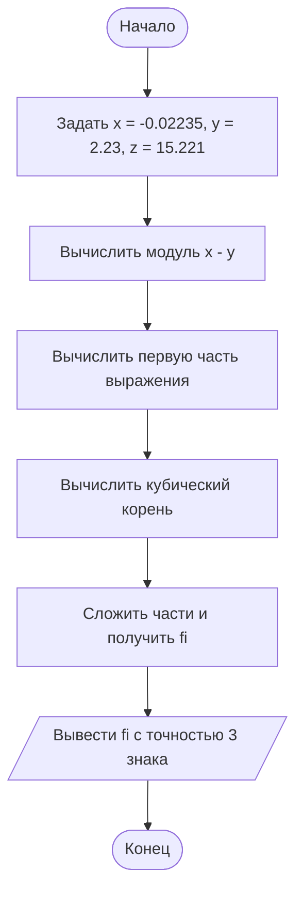

# Задание 8. Вычисление математического выражения

## Условие задачи

Создать программу вычисления указанной величины. Результат проверить при заданных исходных значениях.

Необходимо вычислить выражение:

$$
\varphi=\frac{e^{|x-y|}\cdot |x-y|^{x+y}}{\operatorname{arctg}x+\operatorname{arctg}z}+\sqrt[3]{x^6+\ln^2 y}
$$

Исходные значения: **x = −2.235 × 10⁻²**, **y = 2.23**, **z = 15.221**.

## 1. Алгоритм и блок-схема

### Алгоритм

1. Начало.
2. Подключить библиотеки для ввода-вывода и математических вычислений.
3. Задать значения переменных `x`, `y`, `z`.
4. Вычислить модуль разности `|x − y|`.
5. Вычислить первую часть выражения: произведение экспоненты и степени, разделённое на сумму арктангенсов.
6. Вычислить вторую часть выражения: кубический корень из суммы шестой степени `x` и квадрата натурального логарифма `y`.
7. Сложить обе части и записать результат в `fi`.
8. Вывести результат с точностью до трёх знаков после запятой.
9. Конец.

### Блок-схема



## 2. Реализация программы

Программа написана на языке **C** для **Microsoft Visual Studio**.

```c

#include <stdio.h>
#include <math.h>
#include <windows.h>

int main(void)
{
    SetConsoleOutputCP(65001);

    double x = -2.235e-2;
    double y = 2.23;
    double z = 15.221;
    double fi;

    fi = exp(fabs(x - y)) * pow(fabs(x - y), x + y)
        / (atan(x) + atan(z))
        + cbrt(pow(x, 6) + pow(log(y), 2));

    printf("Результат: %.3f\n", fi);

    return 0;
}

```

Для запуска в Visual Studio создать проект, добавить файл `main.c` и нажать **Ctrl + F5**. Если русские буквы отображаются неправильно, сохранить исходный файл в кодировке UTF-8 и настроить кодировку консоли.

## 3. Результат работы программы

**Исходные данные:**

- `x = -0.02235`
- `y = 2.23`
- `z = 15.221`

**Что выводит программа:**

```text
Результат: 39.374
```

**Проверка:** вычисленное значение до округления составляет приблизительно `39.374125`. После округления до трёх знаков получается **39.374**, что совпадает с контрольным значением из условия.

**Вывод:** программа правильно вычисляет заданное математическое выражение при указанных значениях переменных.

## 4. Информация о разработчике

**Жаворонков Богдан, бТИИ-262**
